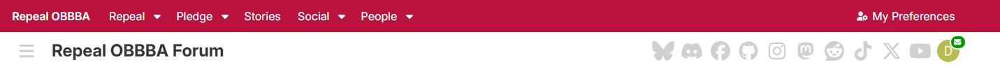
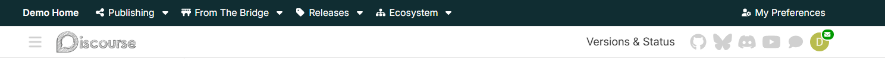
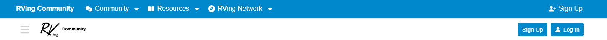

# Brand Navigation

[](https://github.com/CodeWorksLabs/brand-navigation/releases)

Give your Discourse community a recognizable header and clear navigation.
Brand Navigation combines your logo, links and dropdowns with text or icon
destinations in Discourse's own header. It is independently maintained, not an
official Discourse product.

**[Install](#installation) · [Documentation](https://docs.codeworkslabs.dev/brand-navigation/) · [Live examples](#preview)**

## Preview

Compare these live configurations. Site content and navigation may change
after the screenshots are captured.

### Repeal OBBBA Forum

[Open the live forum](https://forum.repealobbba.org/)



### The Bridge demonstration site

[Open the live demo](https://bridge.demo.discussionbridge.dev/)



In this screenshot, the “Versions & Status” text link is supplied by the
separate Custom Header Links component. Brand Navigation now supports header
text links on `main`; this screenshot does not demonstrate that newer capability.

### RVing Community

[Open the live community](https://www.rving.community/)



## What Brand Navigation does

- Add a brand name and optional light/dark logos, plus one-level dropdowns.
- Put text, icons or icons with labels beside the logo or with the core header
  controls, before **Sign Up** and **Log In**. Existing links default to right.
- Set separate header-icon normal and hover/keyboard-focus colors, inheriting
  the active theme by default without recoloring text or Discourse's icons.
- Choose each link's audience and device visibility; use a mobile menu, bar or
  hidden mode.
- Edit friendly **Menu item** and **Submenu item** rows; back up or transfer
  settings with validated JSON bundles.

## Installation

In **Admin → Appearance → Themes & components → Components**, choose
**Install → From a git repository**:

```text
https://github.com/CodeWorksLabs/brand-navigation.git
```

Start on a non-default staging theme. Attach Brand Navigation there, turn its
native **Enabled?** control on, then use Discourse's theme **Preview** to
configure and verify it before attaching it to visitor-facing themes.

If the component is already used by a live theme, use a separate test copy or
staging site. Themes attached to the same component share its code and settings.

**Enabled?** is the only activation switch. A disabled component cannot load
its custom bundle panel. Follow the
[administrator guide](docs/USER_GUIDE.md#install-the-component) for setup,
bundle import and verification. Sample navigation is included.

## Known working Discourse versions

Recorded checks cover Discourse 2026.7 ESR, 2026.8 and 2026.9 installations.
See the [testing record](docs/TESTING.md) for exact builds and limits—not a
blanket compatibility or accessibility guarantee. Keep labels short on narrow
screens; header space is finite.

## In use on

Alongside the previews above, recorded installations include
[DiscussionBridge Forum](https://forum.discussionbridge.dev/),
[Citizen Activist Network](https://forum.citizenactivist.network/),
[R744 Community](https://www.r744.community/) and the
[DiscussionBridge sandbox](https://sandbox-forum.discussionbridge.dev/).
They do not necessarily run the same revision; consult the testing record.

## Navigation model

Use direct links, submenu-only groups, or linked parents with separate carets.
Core-header destinations are direct links, not submenus. See the
[administrator guide](docs/USER_GUIDE.md) and [technical reference](docs/) for
configuration, architecture, testing and [project history](docs/PROJECT_HISTORY.md).

## Versions and updates

Git installation tracks branch commits: `main` contains the RC2 features
described here and can be newer than a tagged download. Use the release badge
above and [GitHub Releases](https://github.com/CodeWorksLabs/brand-navigation/releases)
to find published versions, and read the [changelog](CHANGELOG.md) before updating.

`main` targets current Discourse; maintained older versions use
`d-compat/<YYYY>.<M>`. Review
[migration and rollback](docs/MIGRATION.md#roll-back-brand-navigation-to-a-release-tag)
and its testing limits before relying on pin-and-return recovery. Older
compatibility branches may not include every feature shown here.

## Translations

English is bundled; administrators can override interface text in **Theme
translations**. Detailed validation messages remain English. Configured link
labels are shared site content, not per-locale translations.

## Thanks

Brand Navigation was newly authored from its specifications. Thanks to
[Discourse Brand Header](https://github.com/discourse/discourse-brand-header)
and
[Discourse Header Submenus](https://github.com/discourse/discourse-header-submenus)
for product inspiration, and
[Custom Header Links (icons)](https://github.com/discourse/discourse-icon-header-links)
for demonstrating compact header destinations. Pavilion's
[Dropdown Header](https://github.com/paviliondev/discourse-dropdown-header)
also informed presentation and administration exploration. The current header
binding is independently authored using Discourse's documented API. See
[attribution and licensing](docs/ATTRIBUTION.md) and
[AI-assisted authorship/provenance](docs/PROVENANCE.md) for precise source credits.

## Support

Ask questions or report bugs through
[GitHub Issues](https://github.com/CodeWorksLabs/brand-navigation/issues).
Include component/Discourse versions, theme, browser/device, reproduction steps
and sanitized settings. Never post credentials, personal data or private vulnerability details;
report suspected vulnerabilities to
[security@codeworkslabs.dev](mailto:security@codeworkslabs.dev) under the
[security policy](SECURITY.md).

## License

Copyright (c) 2026 CodeWorksLabs. Licensed under the
[GNU General Public License, version 2 or later](LICENSE)
(`GPL-2.0-or-later`).
